# Denhaag Bar tuyển BOOKING không giới hạn: không lương cứng, hoa hồng 25% + thưởng tháng đến 5 triệu

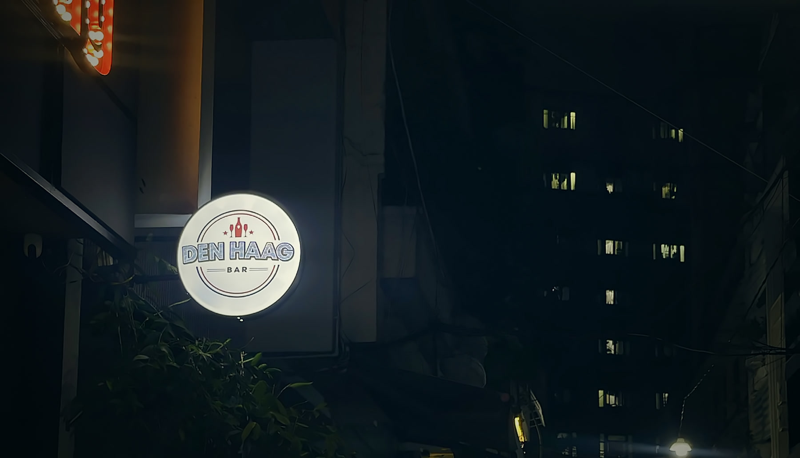

**Bạn có nhiều bạn bè, quen biết rộng và thích rủ người ta đi chơi? Vậy thì chuyện đó hoàn toàn có thể thành thu nhập.**

Denhaag Bar (biển hiệu DEN HAAG BAR) — quán bar & cà phê về đêm ở TP. Hồ Chí Minh — đang mở rộng đội **BOOKING** (người dẫn khách, đặt bàn cho quán) và tuyển **không giới hạn số lượng**. Bạn rủ được bao nhiêu khách, quán chia hoa hồng tương xứng bấy nhiêu.

Lời anh chủ quán gửi đến các bạn:

> "Anh không cần các bạn ngày nào cũng có mặt ở quán. Anh cần những bạn có nguồn khách và chủ động. Phần còn lại, quán và team marketing sẽ hỗ trợ."

## Quyền lợi: 3 điểm "KHÔNG" và 1 điểm "CÓ"

- **Không cần đến quán mỗi ngày.** Bạn chủ động sắp xếp thời gian, có khách thì dẫn đến.
- **Không lương cứng, nhưng hưởng 25% hoa hồng trên tổng bill (trước thuế).** Bill của khách bạn dẫn càng lớn, phần của bạn càng nhiều.
- **Không áp KPI bắt buộc.** Không bị ép chỉ tiêu. Bạn nào đạt hiệu suất tốt sẽ được thưởng thêm theo năng lực.
- **CÓ thưởng cuối tháng**, cộng thêm vào hoa hồng (xem bảng bên dưới).

## Bảng thưởng cuối tháng

Cuối mỗi tháng, quán tổng kết và thưởng theo **tổng bill booking** của bạn trong tháng. Khoản thưởng này **cộng thêm** vào 25% hoa hồng.

| Tổng bill booking trong tháng | Thưởng thêm |
|---|---|
| 20 triệu | 2 triệu |
| 30 triệu | 3 triệu |
| 40 triệu | 4 triệu |
| 50 – 100 triệu | 5 triệu |

Bạn nào nguồn khách dồi dào, anh chủ sẽ cân nhắc **hỗ trợ thêm tiền nước và deal riêng**, trao đổi trực tiếp khi bạn bắt đầu làm việc.

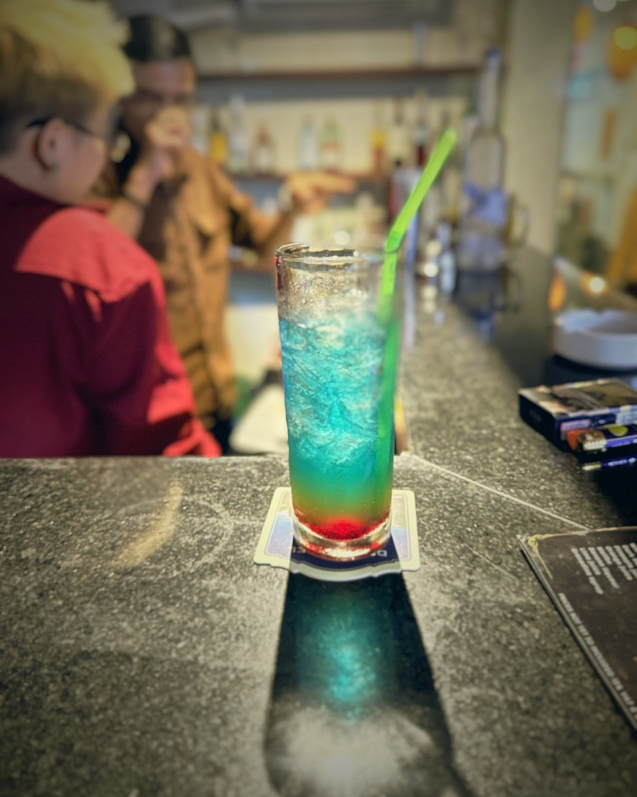

## Ví dụ thu nhập (minh hoạ)

Các con số dưới đây chỉ để bạn hình dung cách tính, **không phải cam kết thu nhập**. Thu nhập thực tế phụ thuộc vào lượng khách và tổng bill của bạn mỗi tháng.

| Tổng bill trong tháng | Hoa hồng 25% | Thưởng tháng | Tổng có thể nhận |
|---|---|---|---|
| 20 triệu | 5 triệu | 2 triệu | 7 triệu |
| 40 triệu | 10 triệu | 4 triệu | **14 triệu** |
| 100 triệu | 25 triệu | 5 triệu | **30 triệu** |

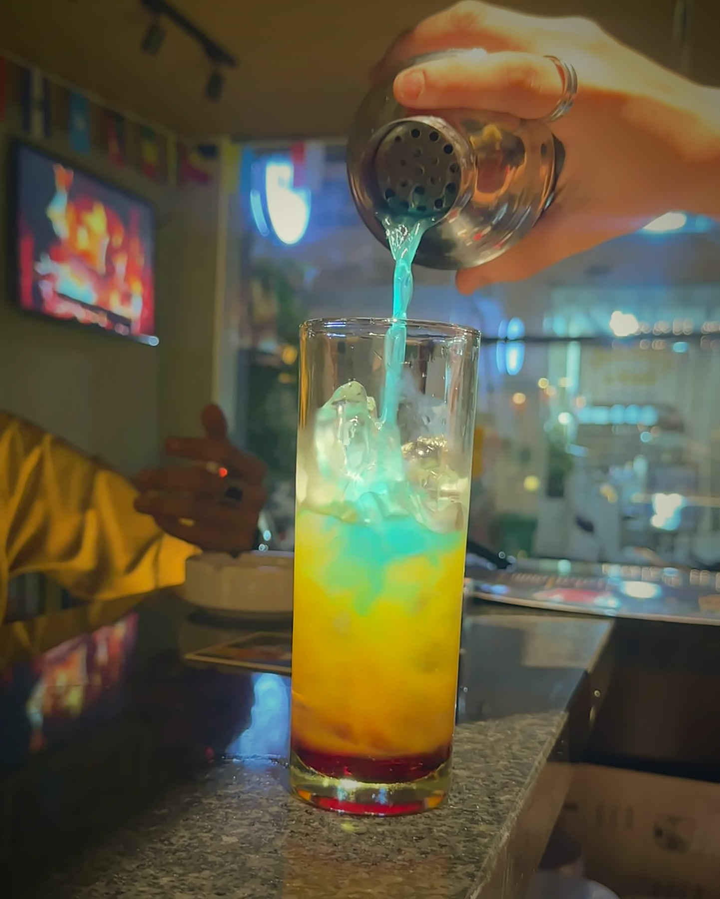

## Không gian Denhaag Bar — nơi bạn sẽ dẫn khách đến

Quầy bar đèn vàng, cocktail nhiều màu, góc ngồi thoải mái và con hẻm sáng đèn giữa lòng Sài Gòn.

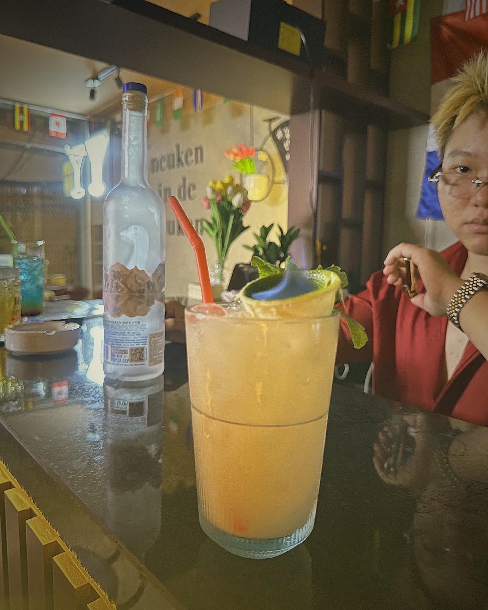
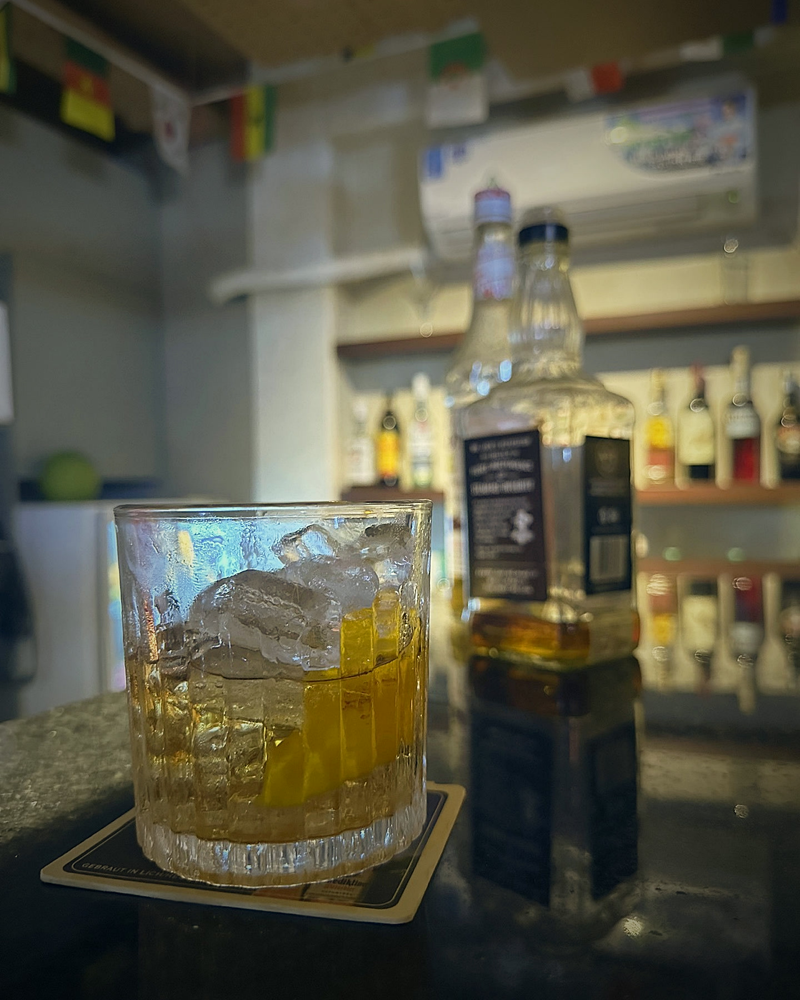
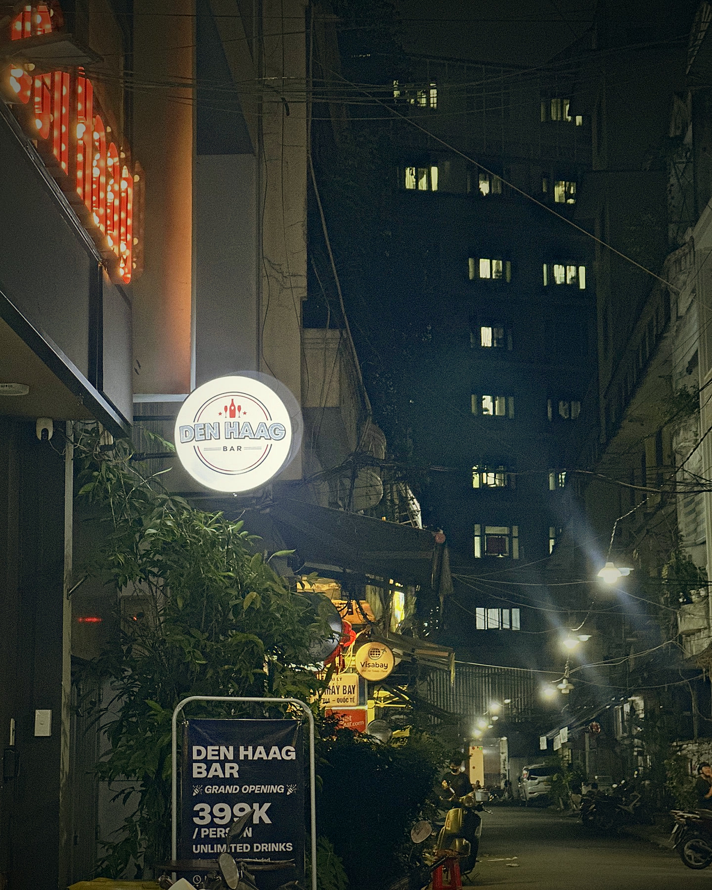
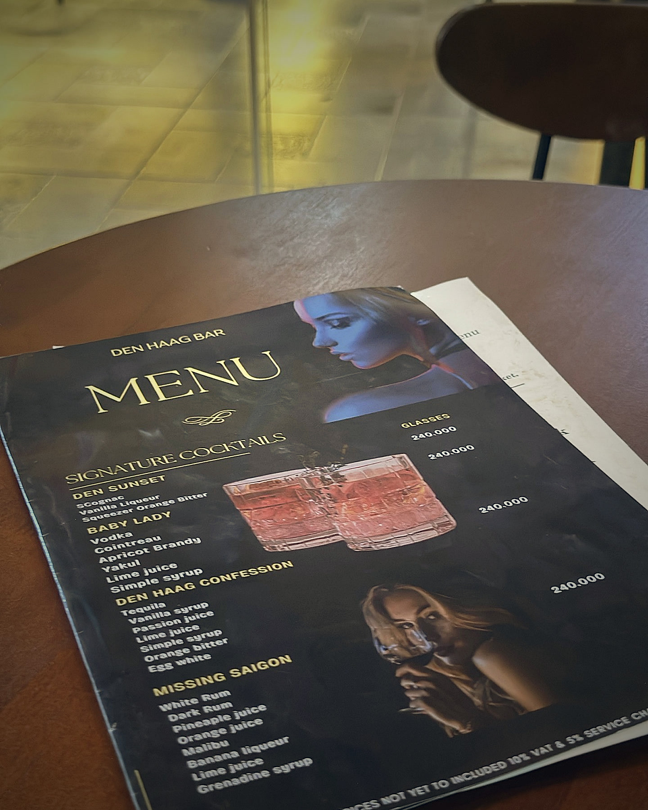
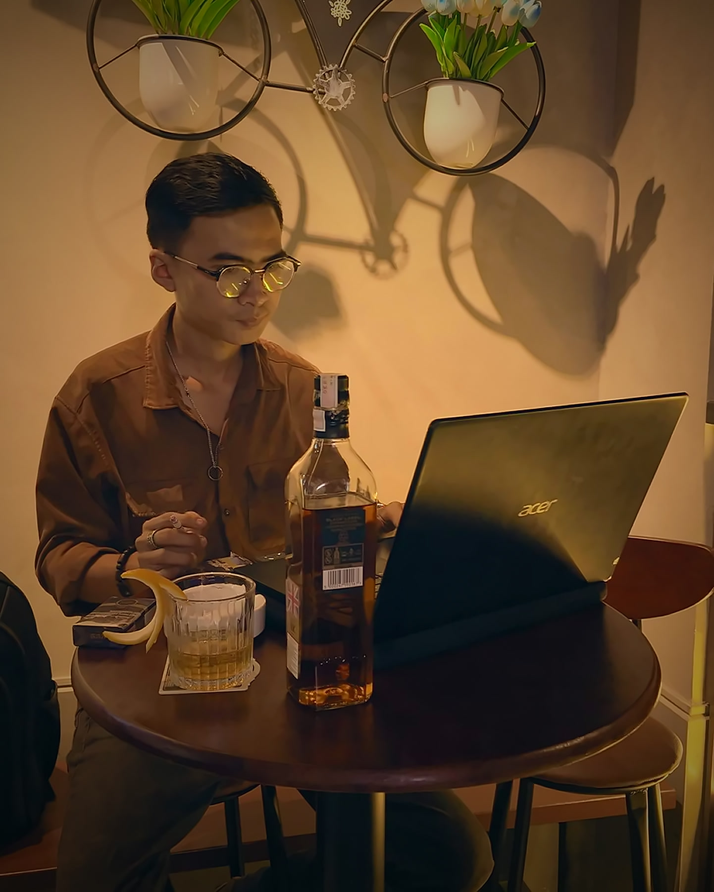
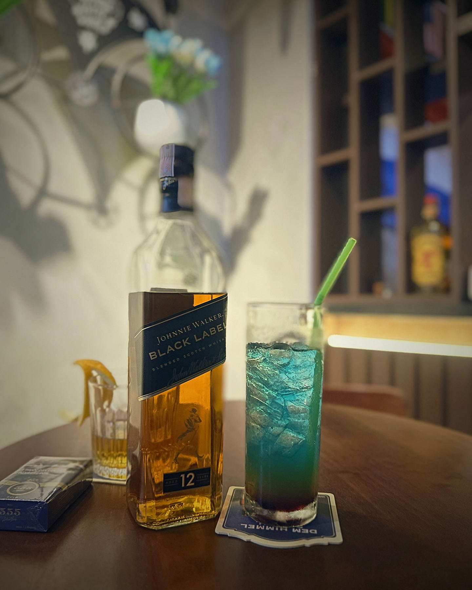
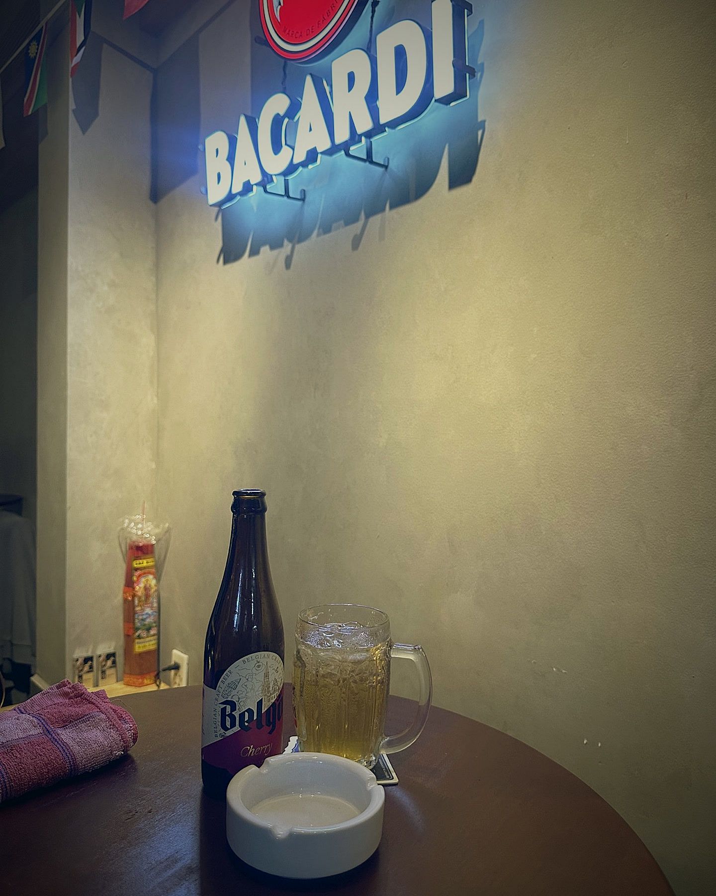
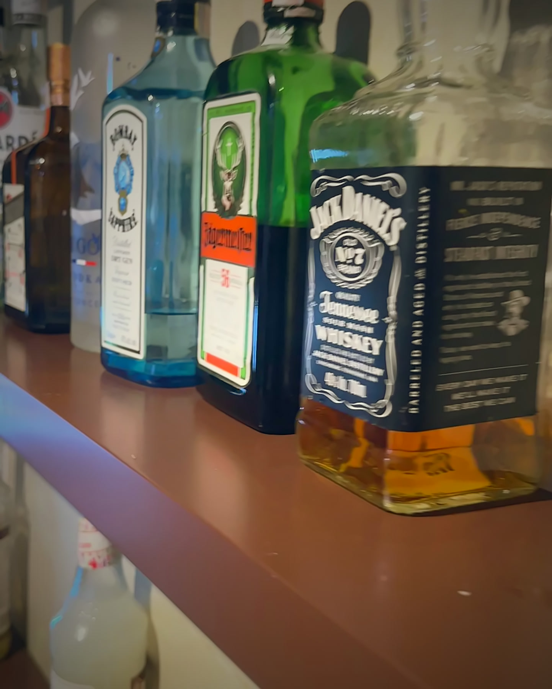

## Bạn phù hợp nếu...

- Bạn có nhiều mối quan hệ, bạn bè, đồng nghiệp, hội nhóm hay đi chơi.
- Bạn thích giao lưu, nói chuyện dễ gần.
- Bạn chủ động, biết tự tìm khách mà không cần ai nhắc.
- Bạn muốn một nguồn thu nhập linh hoạt, không bó buộc giờ giấc.

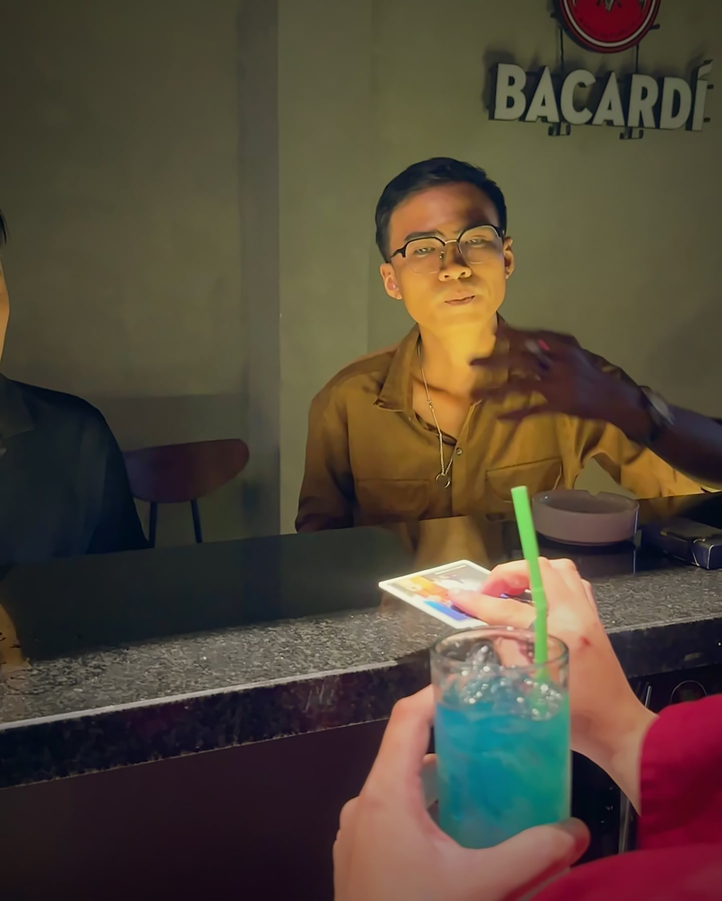

## Cách ứng tuyển

1. Nhắn Zalo hoặc gọi **036 800 2371**, hoặc inbox fanpage Denhaag Bar.
2. Cho quán biết tên và bạn đang có nguồn khách như thế nào.
3. Trao đổi nhanh với quán, nhận thông tin đặt bàn và quy trình dẫn khách.
4. Bắt đầu dẫn khách và theo dõi bill của mình.

**Liên hệ ngay: 036 800 2371 (Zalo)**
Địa chỉ quán: **135/23 Trần Hưng Đạo, P. Cầu Ông Lãnh, Quận 1, TP. Hồ Chí Minh**
Fanpage: https://www.facebook.com/p/Denhaag-Bar-61573715630399/

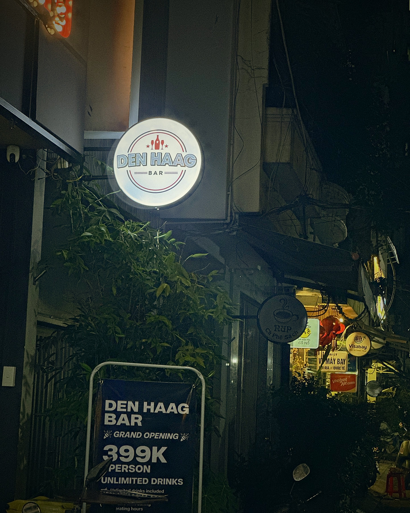

## Câu hỏi thường gặp

**Tôi có phải đến quán mỗi ngày không?**
Không. Bạn chỉ cần dẫn khách đến khi có khách, không bắt buộc đến mỗi ngày.

**Có lương cứng không?**
Không có lương cứng. Bạn hưởng 25% hoa hồng trên tổng bill (trước thuế) của khách bạn dẫn.

**Có bị áp KPI không?**
Không áp KPI bắt buộc. Bạn nào đạt hiệu suất tốt sẽ được thưởng thêm theo năng lực.

**Tuyển bao nhiêu bạn?**
Không giới hạn số lượng. Ai có nguồn khách và muốn làm đều có thể ứng tuyển.

**Thưởng cuối tháng tính thế nào?**
Theo tổng bill booking trong tháng, cộng thêm vào hoa hồng 25%. Xem bảng thưởng ở trên.

---

*Thu nhập minh hoạ chỉ mang tính tham khảo, không phải cam kết. Chính sách có thể được quán cập nhật, vui lòng xác nhận lại khi trao đổi trực tiếp.*
